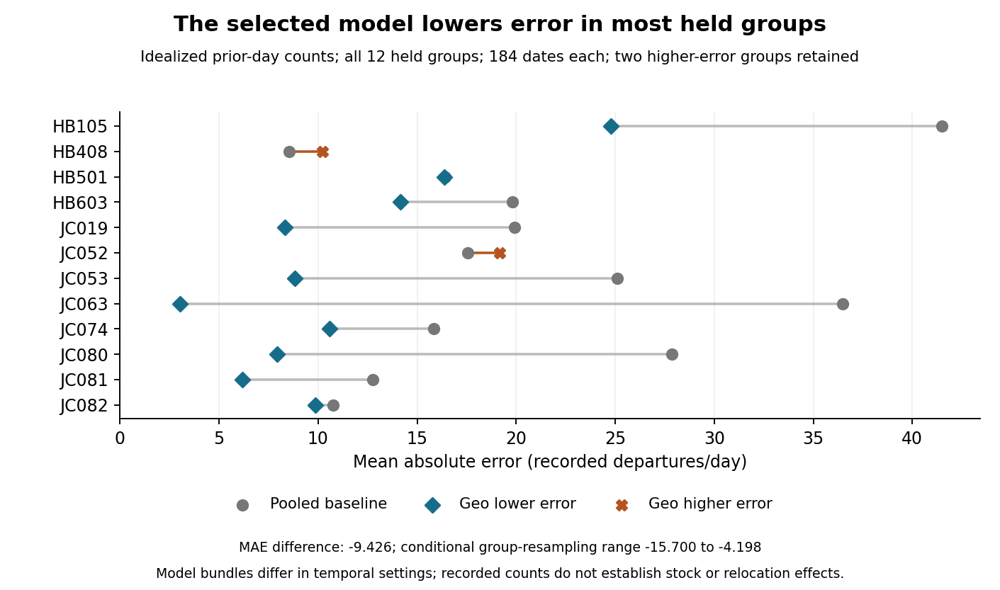

# Recorded departure transfer with held station geography

Can geographical pooling transfer recorded departure counts when a station history is withheld? This fixed retrospective comparison uses published 2024 departure rows and initial-quarter coordinate medians. It simulates cold start on previously observed station IDs; it does not verify actual openings, relocations, bike stock or dock availability.

Conditional finding. Across 12 held coordinate groups and 2,208 station-days, geographic MAE is 11.621 departures/day versus 21.047 for a pooled weekday baseline, a 44.8% reduction. Two groups have higher errors. Temporal settings also differ between the selected model and baseline, so the comparison does not isolate geography's contribution. All 54 validation candidates and the full held stress grid remain available.

Next evidence. Test count transfer prospectively only after verifying station identity, geometry and input vintages. Immediate complete prior-day donor counts are an idealized assumption; the public files were posted later. Obtain stock, availability and opening/relocation telemetry before a rebalancing decision. No operational benefit or realized savings is established.

## Complete primary metrics

MAE/RMSE are departures/day, MSE is (departures/day) squared and WAPE is percent. All 2,208 labels are captured published counts, not stock or latent demand.

| Model | MAE | MSE | RMSE | WAPE (%) |
| --- | --- | --- | --- | --- |
| Geographic | 11.621 | 248.883 | 15.776 | 31.354 |
| Pooled | 21.047 | 646.883 | 25.434 | 56.785 |

## All held groups

| Group | Days | Recorded rows | Geo MAE | Pooled MAE | Difference |
| --- | --- | --- | --- | --- | --- |
| HB105 | 184 | 14,917 | 24.789 | 41.491 | -16.702 |
| HB408 | 184 | 7,804 | 10.206 | 8.537 | 1.669 |
| HB501 | 184 | 9,825 | 16.372 | 16.417 | -0.045 |
| HB603 | 184 | 10,851 | 14.169 | 19.823 | -5.654 |
| JC019 | 184 | 4,145 | 8.333 | 19.921 | -11.588 |
| JC052 | 184 | 9,680 | 19.176 | 17.556 | 1.620 |
| JC053 | 184 | 3,191 | 8.820 | 25.106 | -16.286 |
| JC063 | 184 | 1,096 | 3.038 | 36.492 | -33.454 |
| JC074 | 184 | 4,913 | 10.577 | 15.843 | -5.265 |
| JC080 | 184 | 2,685 | 7.927 | 27.856 | -19.929 |
| JC081 | 184 | 5,501 | 6.181 | 12.765 | -6.584 |
| JC082 | 184 | 7,231 | 9.867 | 10.759 | -0.892 |

## Every validation configuration

Equal-coordinate-group MAE, departures/day. All 54 settings; fixed pooled validation MAE 23.127.

| Calendar | k | Exponent | 28 days | 56 days | 84 days |
| --- | --- | --- | --- | --- | --- |
| Weekday | 3 | 0 | 21.343 | 20.841 | 20.747 |
| Weekday | 3 | 1 | 21.566 | 21.042 | 20.928 |
| Weekday | 3 | 2 | 21.804 | 21.232 | 21.097 |
| Weekday | 5 | 0 | 20.563 | 20.116 | 20.151 |
| Weekday | 5 | 1 | 20.495 | 20.071 | 20.108 |
| Weekday | 5 | 2 | 20.917 | 20.466 | 20.481 |
| Weekday | 10 | 0 | 21.407 | 20.918 | 20.872 |
| Weekday | 10 | 1 | 20.908 | 20.478 | 20.469 |
| Weekday | 10 | 2 | 20.972 | 20.519 | 20.520 |
| Weekday/weekend | 3 | 0 | 21.283 | 20.763 | 20.663 |
| Weekday/weekend | 3 | 1 | 21.530 | 20.997 | 20.860 |
| Weekday/weekend | 3 | 2 | 21.783 | 21.204 | 21.051 |
| Weekday/weekend | 5 | 0 | 20.467 | 20.021 | 20.034 |
| Weekday/weekend | 5 | 1 | 20.423 | 19.996 | 20.017 |
| Weekday/weekend | 5 | 2 | 20.867 | 20.420 | 20.406 |
| Weekday/weekend | 10 | 0 | 21.331 | 20.827 | 20.797 |
| Weekday/weekend | 10 | 1 | 20.849 | 20.398 | 20.403 |
| Weekday/weekend | 10 | 2 | 20.928 | 20.474 | 20.453 |

## Every held month

| Month | Station-days | Geo MAE | Pooled MAE | Difference |
| --- | --- | --- | --- | --- |
| 2024-07 | 372 | 11.101 | 20.098 | -8.997 |
| 2024-08 | 372 | 11.259 | 20.189 | -8.930 |
| 2024-09 | 360 | 13.962 | 22.532 | -8.570 |
| 2024-10 | 372 | 11.839 | 21.497 | -9.658 |
| 2024-11 | 360 | 10.912 | 21.489 | -10.578 |
| 2024-12 | 372 | 10.707 | 20.540 | -9.832 |

## Every geometry stress

Same labels reused; synthetic metadata changes do not establish physical relocation effects.

| Shift (m) | Bearing (deg) | Geo MAE | Change from unshifted | Difference from pooled |
| --- | --- | --- | --- | --- |
| 0 | n/a | 11.621 | 0.000 | -9.426 |
| 100 | 0 | 12.510 | 0.889 | -8.537 |
| 100 | 45 | 12.528 | 0.906 | -8.520 |
| 100 | 90 | 11.399 | -0.222 | -9.648 |
| 100 | 135 | 11.527 | -0.094 | -9.520 |
| 100 | 180 | 11.190 | -0.431 | -9.857 |
| 100 | 225 | 11.628 | 0.007 | -9.419 |
| 100 | 270 | 11.916 | 0.294 | -9.132 |
| 100 | 315 | 12.665 | 1.043 | -8.383 |
| 500 | 0 | 16.782 | 5.161 | -4.265 |
| 500 | 45 | 15.999 | 4.378 | -5.048 |
| 500 | 90 | 15.255 | 3.633 | -5.793 |
| 500 | 135 | 11.311 | -0.311 | -9.737 |
| 500 | 180 | 11.173 | -0.449 | -9.875 |
| 500 | 225 | 13.407 | 1.786 | -7.640 |
| 500 | 270 | 16.033 | 4.411 | -5.015 |
| 500 | 315 | 15.117 | 3.496 | -5.930 |

## Evidence and limits

The source has 1,052,451 rows; independent parser hashes match 4,209,804 selected scalars. Initial-only screens yield 83 IDs, 49 donor IDs, 22 validation groups and 12 held groups. Nineteen fixtures, 1,673,256 exact result fields and 477,012 numerical checks pass. Isolated replay checks 1,643,477 exact fields and 505,372 numeric-tolerance fields, three documents and 24 frozen dependencies. All three figures are original and checked.

The conditional group-resampling MAE-difference range is −15.700 to −4.198 departures/day; it is not guaranteed confidence or future coverage. Groups may remain dependent. Public files were posted later, so actual historical availability remains unknown. Recorded starts omit failed attempts, stock and dock occupancy. Initial activity/geometry screens do not establish surveyed physical identity, real new-site transfer or relocation outcomes. No causal, realized-savings, operational-benefit or novelty claim.

Read PROTOCOL.md, FREEZE.json, exact source hashes, complete exclusions, predictions, donor histories, weights, candidate/runtime records and the independent manuscript. Source files and customer/trajectory attributes remain private/excluded; coarse derivatives appear only within this noncommercial study. Formal-publication projects including Azure remain private.
